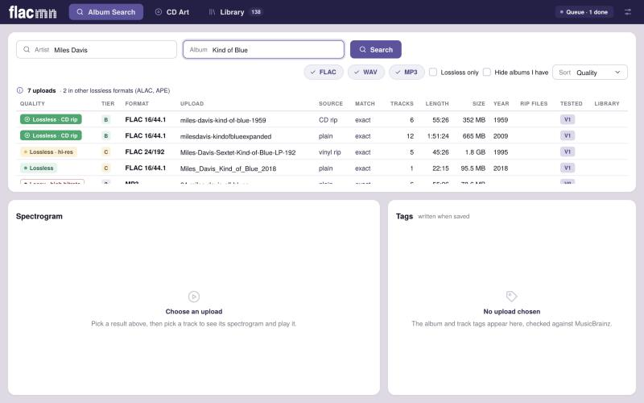
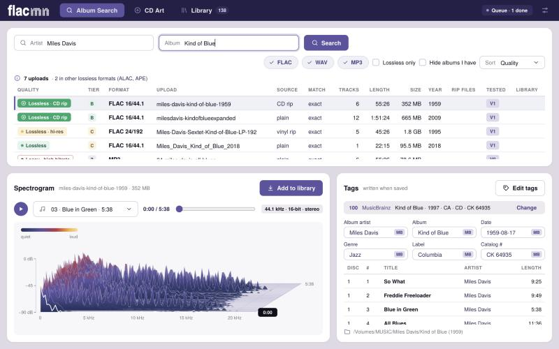
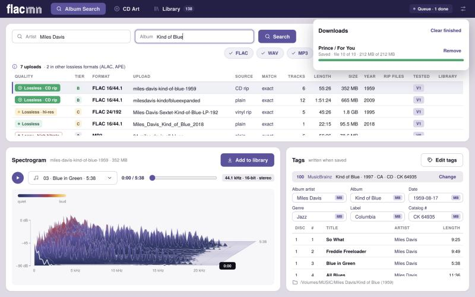
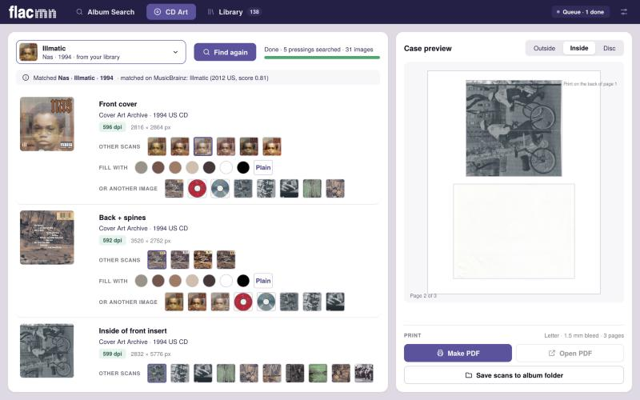
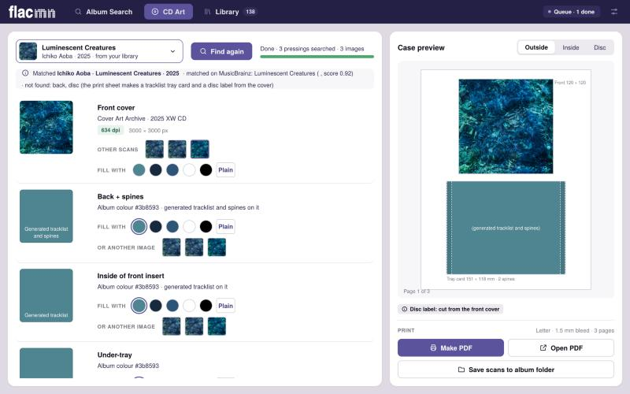
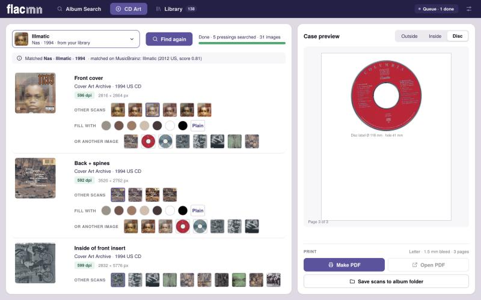

# iaflac

Find high-quality lossless albums on the [Internet Archive](https://archive.org), from any source (CD rips, lossless
and hi-res downloads, vinyl and tape transfers), and check that the files really are lossless. Give it a list of
artists/albums, or a genre.

```bash
python3 -m iaflac find -f wanted.example.txt          # look up a list (one "Artist - Album" or "Artist" per line)
python3 -m iaflac find "Miles Davis - Kind of Blue"   # or pass requests directly
python3 -m iaflac find "Miles Davis - Kind of Blue"   # search, test what you pick, then confirm saving it into your library
python3 -m iaflac genre shoegaze --years 1988-1996    # discover by genre
python3 -m iaflac find "Miles Davis - Kind of Blue" --search-only   # just list what was found: test nothing
python3 -m iaflac verify <identifier> --deep --spectral   # check one item as hard as possible
python3 -m iaflac get <identifier> --dest ~/Music/IA      # lists files and sizes; add --yes to download
python3 -m iaflac replace --scan                      # albums you have only as MP3 (then: replace "Artist/Album")
```

**Desktop app: flacmn.** `python -m pip install -e ".[gui]"` then `python -m iaflac.gui` opens a window over the
same engine: Album Search (every format ranked together, pick a track to see its 3D spectrogram and play it, MusicBrainz-checked
tags), Case Art (CD jewel cases and cassette J-cards: scans, true-size print sheets and a 3D preview), Library and Health Check (missing songs, low quality, missing art and duplicates; see below), with a download queue that saves albums as
`Artist/Album (Year)/NN - Title.flac` for players such as Volumio. On a Mac, `bash packaging/macos/dev_setup.sh` does
the whole setup from a checkout and opens it (`--app` also builds `dist/flacmn.app`). Installers are built by
`.github/workflows/release.yml`; see `packaging/README.md`.

Needs Python 3.10+ with `requests numpy scipy matplotlib pyyaml`, plus the `flac` and `ffmpeg` binaries.
Run it from this folder. Reports land in `runs/<timestamp>-<name>/` (`report.md`, `report.csv`,
`candidates.json`, `spectrograms/`). `SKILL.md` teaches Claude to drive it.

## flacmn walkthrough: the desktop app

The same steps as the walkthrough below, in the window instead of the terminal.

**1. Search archive.org.** Type an artist and an album in Album Search. Every format is ranked together, best quality
first (lossless and hi-res alike, then lossy); here a lossless copy of Kind of Blue tops the list.



**2. Check the spectrogram.** Pick a result and a track, and its 3D spectrogram draws on its own (press play to listen).
The tags on the right are checked against MusicBrainz.



**3. Add it to your library.** Downloads queue up and are checked against archive.org's checksums before they are filed
as `Artist/Album (Year)/NN - Title.flac`.



**4. Find the CD case scans.** CD Art looks in the album folder, on archive.org and in the Cover Art Archive, including
other pressings of the same CD.



**5. Fill in what's missing.** No back or inside scan? Those parts take colours from the cover, with the tracklist
printed on them, or any other image found for the album.



**6. Print the case.** Make PDF writes one true-size PDF: the front insert, the tray card with spines, the inside, and
the disc label.



## Walkthrough: from a wish list to a verified album in your library

This takes one album from a search to your library and inventory, in one command. Nothing is tested until you pick it,
and nothing is saved until you confirm it. Run everything from this folder.

**1. Check the setup (once).**

```bash
python3 --version                       # 3.10 or newer
python3 -c "import requests, numpy, scipy, matplotlib, yaml"   # no output means the packages are there
flac --version && ffmpeg -version | head -1
```

If an import fails, `pip install requests numpy scipy matplotlib pyyaml`. If `flac` or `ffmpeg` is missing on a Mac,
`brew install flac ffmpeg`.

**2. Say what you want.** Pass requests on the command line, or put one per line in a text file (`Artist - Album`, or
just `Artist`; lines starting with `#` are comments; `.csv` with `artist,album` also works). See `wanted.example.txt`.
An album request finds far better matches than an artist-only one, which returns whatever uploads mention the name.

**3. Search, and read the list. Nothing is tested yet.**

```bash
python3 -m iaflac find "Miles Davis - Kind of Blue"
```

You get a numbered list of everything archive.org has for the request. Each entry shows the FLAC count, runtime, size,
year, downloads, which rip files it ships (`log`, `cue`, `.accurip`), cover art, licence, track names, and what the
uploader's description claims. Read it for the signs of a complete, genuine album: a track count and runtime that match
the album, a name that matches ("exact match", not "weak match"), and any evidence of its source (a rip log and cue for
a CD, a named store or label for a download, a transfer note for vinyl or tape). Entries marked "another upload or
edition of #1" are duplicates of the same album. To stop here, add `--search-only`.

**4. Choose what to test.** At the prompt, press Enter to test the top entry, type numbers such as `1,3` or `2-4`,
`a` for all, `s` to skip this request, or `q` to quit. The tests read the files, so pick the entries you would
actually keep. The best pick also gets a full decode test and a spectrum check, which streams that album's whole
FLAC set (the size is in the listing). Add `--deep none` to skip that and only read headers and the rip log.

**5. Read the report.** The run writes a folder under `runs/` and prints a summary. Open `report.md` in it. Each
tested item has a tier and the evidence behind it:

| Tier | Meaning |
|---|---|
| **A** | Genuine lossless, strong evidence: a verified rip log with aligned tracks, or a clean spectrum and decode test with corroboration (such as real content above 22 kHz) |
| **B** | Genuine lossless, likely |
| **C** | Lossless, little evidence either way |
| **L** | Lossy VBR MP3, offered only when no FLAC or WAV exists (see "When there is no FLAC") |
| **D** | Failed or suspect: not FLAC, failed the decode test, or a lossy spectrum |

Tiers describe how sure the tool is that the audio is genuinely lossless, from any source; no source or resolution is
preferred. A tier C item can be a perfectly good lossless file that simply hasn't been checked deeply yet. Also look for `V2 ✓ n/n files decode cleanly` (every file passed `flac -t` and matched archive.org's
checksum) and the spectrum verdict; open the PNG in `spectrograms/` if it says `SUSPECT`.

**6. Confirm the save.** After the tests, a **Save** section lists the albums you tested that can be saved (tiers A to
C; tier D is never offered), each with the artist and album name it would be filed under, size, the tests it passed and
the evidence. Only albums you tested are listed, but every one of them is offered, not just the few the report shows:
other uploads of the same album are marked `(another upload of #1)`, and an album your inventory already lists (say,
one you lost and are downloading again) is marked `(in your inventory: downloads again, no rows added)` and keeps the
inventory's spelling of its name, so it goes back under the same name. If more than one is listed you choose with numbers such as `1,3`,
`2-4` or `a` (Enter saves nothing); if there is one, you go straight to the next step. The first time, it asks where
your music library is and remembers the answer (`~/.config/iaflac/config.json`), so later runs don't ask.

```bash
python3 -m iaflac find "Miles Davis - Kind of Blue"
```

**7. Review, then say yes.** Before anything is written you see, for each album: the folder it will go to
(`~/Music/Miles Davis/Kind of Blue/`), the first track names, the file count and size, the cover art, and the exact rows
that would be added to your inventory. Then one question: `y` saves right away, `e` lets you correct the artist and album
names (archive.org titles are messy, so check them), and `n` or Enter cancels. Nothing has been downloaded before your `y`.

**8. It is saved in the format your library already uses.** The tool copies the library's own conventions:

- folders `<Artist>/<Album>/`, using the artist spelling already in your library (`Boards of Canada`, not `Boards Of Canada`)
- tracks named `01 Title.flac`, the most common style in the library (`--track-names keep` keeps archive.org's names instead)
- a `cover.jpg` (`--art none` skips it, `--art all` keeps every scan)
- audio and cover only, since the library has no rip logs (`--rip-files keep` adds the `.log/.cue/.accurip`)
- the album added to your inventory workbook, with a timestamped backup made first

Each file downloads to a `.part` name and is renamed only once it matches archive.org's checksum. An album is added to
the inventory only after every file verified, and the inventory rows are read from the downloaded files. It refuses to
merge into a folder holding other files and never overwrites a file that differs. Close the workbook in Excel first,
since an open file stops the write; the download still happens and the command to add it afterwards is printed.

**Choosing the library.** In order: `--library`, then `$IAFLAC_LIBRARY`, then the folder remembered from the first
run. Change it any time with `--library <folder>` plus a fresh answer, or by editing the config file. To set both in
your shell profile instead:

```bash
export IAFLAC_LIBRARY=~/Music
export IAFLAC_INVENTORY=~/Music/Inventory.xlsx    # optional: if the library folder holds exactly one *Inventory*.xlsx it is used
```

`--no-inventory` saves without touching any workbook.

**9. Check the result (optional).**

```bash
python3 -m iaflac inventory check --xlsx ~/Music/Inventory.xlsx    # Summary matches Library
python3 -m iaflac verify <identifier> --deep --spectral            # re-test one item as hard as possible
python3 -m iaflac get <identifier> --library ~/Music --yes         # save one item by identifier, without searching (preview first without --yes)
```

**Discovering by genre instead.** When you don't have a specific album in mind:

```bash
python3 -m iaflac genre shoegaze --years 1988-1996
```

You get a table of album-shaped hits with rip files, size and popularity. Pick which to inspect at the prompt (Enter
inspects the first 30), read the report the same way as in step 5, then save an album you like with `get` (see step 9), or search
for it by name with `find` and use step 6. `--terms "dream pop"` adds search words and `--exclude` removes some.

**Running it unattended.** With no terminal (a script or a pipe) and no `--select`, `find` lists and tests nothing.
Use `--select 1` to answer the test prompt in advance. Saving needs two explicit flags when there is no terminal:
`--save 1` (numbers from the Save list) and `--yes`, for example
`python3 -m iaflac find "Miles Davis - Kind of Blue" --library ~/Music --select 1 --save 1 --yes`.
Without both, nothing is downloaded.

## Search first, then test what you choose

`find` and `genre` work in two phases, and the tests never start until you say so.

1. **Search results.** Each request is searched and every match is listed with what archive.org itself says about it:
   title, number of FLAC files, runtime, size, year, downloads, which rip files it ships (log, cue, `.accurip`),
   whether it has cover art, licence, collections, track names, and what the uploader's description claims. No file is
   opened and there are no verdicts yet.
2. **Tests, for what you pick.** In a terminal you are asked which listed items to test (`Enter` = the top one,
   `1,3`, `2-4`, `a` = all, `s` = skip this request, `d` = `Enter` for all remaining requests, `q` = quit). Only then are
   headers and rip logs read, tiers assigned and, unless `--deep none`, the best pick decoded end to end and
   spectrum-checked (which streams its whole FLAC set; the size is in the listing).

`--search-only` lists and stops. `--select 1` (or `1,3`, `2-4`, `a`) answers the prompt in advance, per request. Without
a terminal (a pipe, a script) and without `--select`, nothing is tested, so nothing expensive can start unasked. Found
items you didn't pick are recorded under "Found but not tested" in the report. `genre` works the same way: it lists
every album-shaped hit in a table and asks which to inspect (`Enter` = the first `--probe`, default 30).

## How a candidate is judged

Each item is verified in levels; a report row says which it reached.

| Level | What | Cost | Catches |
|---|---|---|---|
| V0 | archive.org metadata: FLAC list, sizes, checksums, rip sidecars | 1 request | missing tracks, mislabeled formats |
| V1 | first 32 KB of each FLAC (HTTP Range): `fLaC` magic (ID3 prefix skipped), STREAMINFO, tags. Non-FLAC is named by magic bytes. Duration and size cross-checked against the archive's numbers | ~32 KB per track | MP3/WAV/M4A renamed `.flac`, truncation, CD-format and sector-alignment evidence |
| V2 | every file streamed through `flac -t` (frame CRCs + audio MD5) and compared with archive.org's md5/sha1. Nothing is stored | the whole album | corruption, truncation |
| V3 | three 1.5 MB slices decoded and searched for a lossy codec's lowpass cliff; writes a spectrogram | 5-15 MB | MP3/AAC transcodes, upsampled hi-res |

`find` runs V0+V1 on every candidate and V2+V3 on the top pick per request (`--deep all` for everything).
`genre` runs V0+V1 only (`--deep top` to add the deep checks to the best few).

Tiers (ranking, best first) say how sure we are the audio is genuinely lossless, whatever its source: **A** strong
evidence · **B** likely · **C** little evidence either way · **L** lossy MP3 (fallback only) · **D** failed or suspect.
A clean spectrum, a passed decode test and real hi-res content earn points for any source; a rip log, AccurateRip and
sector-aligned tracks earn points as evidence of a clean CD extraction. No format or source loses points. The weights
are constants in `iaflac/provenance.py`, pinned by tests against real items.

CD-extraction evidence: a CD track is a whole number of 588-sample sectors, so a real rip's tracks all have
`total_samples % 588 == 0`. In real items: an EAC rip 12/12 and 14/14, a 48 kHz "(FLAC)" upload 0/12. Only meaningful
in aggregate (three or more tracks, 90%+).

## Vinyl rips, plain FLAC, and when there is no FLAC

**Every kind of lossless upload is searched alike.** The goal is any high-quality audio, so a name search asks for any
FLAC, whatever its source, and a few result slots are kept for uploads without a rip log so those can't crowd each
other out either way. Each result says what kind of upload it looks like (a claim, not a check): `CD rip (ships a rip
log or cue)`, `CD rip (claimed by the uploader)`, `vinyl rip (claimed by the uploader)`, `web/store source (claimed by
the uploader)`, or `plain FLAC (source not stated)`. All are tiered on the same evidence of genuine lossless audio. Use
`--rip-only` to see only uploads that ship a rip log or cue sheet.

**When there is no FLAC at all**, the search automatically looks again for two other kinds of upload:

| Found | What it is | What saving does |
|---|---|---|
| **WAV** (tried first) | uncompressed and lossless | each WAV is downloaded, checked against archive.org's checksum, encoded to FLAC (`flac --best --verify`, so it is decoded and compared as it is written), tagged, and the WAV removed. The inventory records it as FLAC. |
| **VBR MP3** | lossy (tier L) | saved as MP3, marked `** LOSSY **` in the plan, and recorded in the inventory as `MP3 (VBR 245kbps)`. |

WAVs are tested by reading only their headers (real PCM, sample rate and bit depth, and for 44.1 kHz/16-bit whether
every track is a whole number of CD sectors, which makes it tier B). There is no decode or spectrum test for WAV or MP3:
the download's checksum is the check. `--fallback wav|vbr|both|none` chooses what is looked for (default `both`). `replace`
only ever falls back to WAV, since swapping an MP3 album for another MP3 isn't the point. The fallback is skipped with
`--rip-only`.

## Searching

- **By name:** query ladder per request: exact title restricted to items that ship a rip log or cue sheet
  (archive.org labels those as item formats `Log` and `Cue Sheet`), then any exact title, then relaxed words.
  Artist is matched in `creator` *or* `title` (many uploads have no creator). Matches are confirmed against the
  FLAC's own ARTIST/ALBUM tags; duplicate uploads are grouped with the best copy first; volume/part numbers must
  agree ("II" is not "IV"). If there is no FLAC match you get near misses and other lossless formats, never silence.
- **By genre:** archive.org has no genre field, so `subject:` tags, then title, then description are matched, ranked
  by tag strength, provenance tier, album shape and popularity, and capped per artist. `genres.yml` maps ~30 genres to
  tags and exclusions; anything else searches the literal phrase; `--terms`/`--exclude` extend it.

## Guardrails

Read-only against archive.org's public endpoints; identifies itself; at most 4 requests in flight; on-disk cache
(24 h; `.cache/`); backoff on 429/5xx. Skips access-restricted items. Every row shows licence and collections
(`--free-only` keeps Creative Commons / public-domain / netlabel items). `find`/`genre`/`verify` write only cache and
reports. `get` needs `--yes`, fetches only audio, rip logs and original cover art, refuses names that could escape the
destination, downloads to `.part` files that must match archive.org's checksums, and never executes anything.

## Known limits

- Sector alignment shows CD *origin*, not losslessness (a gapless MP3 decode of a CD rip is also aligned).
- The spectral check catches MP3 128-320 CBR and V2 (63-70 dB cliffs vs 5 dB for real audio) but **misses MP3 V0**
  and other very high bitrates, and can flag band-limited old masters (verdict `SUSPECT`: look at the spectrogram).
- Rip logs and auCDtect reports are uploader-supplied; tier A means strong evidence, not proof. Not built: recomputing
  AccurateRip checksums from the audio and comparing them with the item's `.accurip` (that would be proof), and a
  MusicBrainz track-count completeness check.
- archive.org metadata is free-form and many albums aren't there.
- Cold archive.org requests are slow (metadata ~3 s, ranged reads ~1.8 s), so a first genre run takes about 2 minutes.

## Replacing an album you already have (MP3 to FLAC)

```bash
python3 -m iaflac replace --scan                       # list every album in your library that has audio but no FLAC
python3 -m iaflac replace "Solange/When I Get Home"    # find a FLAC version of that album and replace it
python3 -m iaflac replace "Artist/One" "Artist/Two"    # several at once
```

`replace` is the same pipeline as `find` (search, choose what to test, test, confirm), pointed at an album you already
own. Give it the album folder (`Artist/Album` inside your library, or a path). A plain `find` also notices when the
album you are about to save is an MP3 album you already have, and offers to replace it. The plan then says
`** REPLACES your album (19 MP3) **` and shows the old folder, the old and new track counts (with a warning if they differ,
for example a deluxe edition), and the inventory change. One `y` does everything, in this order:

1. The FLACs are downloaded into a hidden staging folder next to your album and verified against archive.org's checksums.
   **Your MP3s are not touched until every file has verified.** If anything fails, the original stays exactly as it was
   and the partial download is resumed next time.
2. Anything in the old folder that is not audio (booklets, notes, a cover the new album lacks) is copied across.
3. The old folder is moved to the **Trash**, never deleted, so you can put it back. If the Trash isn't usable it goes to a
   hidden `.iaflac-replaced/` folder inside the library. The new folder takes its place, under your existing folder name.
4. In the inventory workbook the album's old rows (`MP3 (CBR 128kbps)`, format `MP3`) are replaced by the new FLAC rows in
   the same place, the Summary is recomputed, and a timestamped backup is made first.

An album that already contains any FLAC is never replaced. Without a terminal, `find --save --yes` will not replace an
album unless you also pass `--replace` (`replace ... --save 1 --yes` counts as explicit).

## Library Health Check: missing songs, low quality, missing art, duplicates

```bash
python3 -m iaflac health                               # check every album in the library
python3 -m iaflac health --musicbrainz                 # also compare tracklists with MusicBrainz (names the missing songs; slow)
python3 -m iaflac health --archive --only missing_tracks,missing_art   # and say which archive.org uploads fix each album
python3 -m iaflac health --merge "Artist/Album" "Artist/Album (Deluxe)"          # the merge plan
python3 -m iaflac health --merge "Artist/Album" "Artist/Album (Deluxe)" --yes    # do it
```

In the app this is the **Health Check** tab. Each album is checked for:

| Problem | What counts |
|---|---|
| **Missing songs** | gaps in the track numbers, fewer tracks than `TRACKTOTAL`/`DISCTOTAL` say, or (with MusicBrainz on) songs of the album's release that are not in the folder. Releases are found from the MusicBrainz IDs in the tags (album, release-track or recording IDs, as Picard writes them), so an album named differently from MusicBrainz is still found. Without IDs, they come from a loose name search (also without a suffix such as " - 50th Anniversary") or from searches for the songs' titles. A release only counts if it holds every song you have (matched by ID, else by title). The release in the tags wins; otherwise the smallest one is used, so a standard edition is not flagged for the deluxe edition's bonus tracks |
| **Low quality** | lossy files (MP3, AAC, Ogg...), lossy below 220 kbps (marked bad), lossless below CD resolution, unreadable files, an album mixing lossless and lossy tracks |
| **Missing art** | no embedded cover and no `cover.jpg`/`folder.jpg`, or a cover under 500 px |
| **Duplicates** | the same album in two or more folders (years and edition words such as "Deluxe" or "Remastered" ignored), or the same song twice in one folder |

Checking reads tags and headers only. Each album is cached by its files' sizes and dates, so a second check only
reads what changed.

**Search the Internet Archive** (one album at a time; "Every album" lists the healthy ones too) searches like Album
Search, with your search settings and every format. It searches under the album's own title and under its plain title
too: "Blonde (FULL ALBUM)" is also searched as "Blonde", which is what most uploads are called. Every upload is listed,
best audio first, with its quality: Lossless, Hi-res (guessed from the bitrate until a header is read), or Lossy with
its bitrate (from the file sizes and lengths). Each one says what it offers your copy:
- which of the missing songs it has (matched by title, or by number when the upload has the same numbering)
- whether it is better than your copy: lossless for a lossy album, or a clearly higher bitrate (220 kbps or more, and
  32 more than yours)
- its cover, plus the Cover Art Archive's front cover when the MusicBrainz release is known

Only item listings are read. Then:

- **Add to album** downloads the ticked tracks into the album folder. Each one is checked against archive.org's
  checksum (and `flac -t`), tagged with the album's names, and named like the tracks already there
  (`03 - Title.flac`). A WAV is encoded to FLAC. A file that is already there is never overwritten.
- **Use as cover** saves `cover.jpg` for an album with none. **Replace cover** (it asks first) moves your cover file
  to the Trash, along with a copy of the embedded cover, writes the new one, and embeds it in the tracks that had one
  embedded. Only their picture changes.
- **Replace album** (any lossless upload, or a clearly higher-bitrate one for a lossy album; it asks first and shows both track counts and formats) downloads the upload
  into a hidden staging folder beside your album and checks every file against archive.org's checksums. Only then does
  your folder go to the Trash, with anything in it that is not audio copied across, and the new one take its place
  under the same folder name, tagged with your artist and album names. If the download fails or is cancelled, your
  album is untouched, and trying again resumes it. A lossy upload only replaces a lossy album, and only when it is clearly better.

**Merge** keeps the best copy of every song in one folder: lossless over lossy, then the higher resolution or bitrate.
The folder with the most lossless songs stays. Songs that only the other copy has are moved in and given the album's
names, and anything in the other folders that is not audio (booklets, a cover) is copied across. The worse copies and
the emptied folders go to the Trash, or `.iaflac-replaced/` in the library when there is no usable Trash. Nothing is
deleted. The plan is always shown first, and a merge is refused if the folders changed after the plan was made.

## Your library and inventory

```bash
python3 -m iaflac get <id> --library ~/Music --inventory ~/Music/Inventory.xlsx --as "<id>=Artist | Album"   # preview
python3 -m iaflac get <id> --library ~/Music --inventory ~/Music/Inventory.xlsx --as "<id>=Artist | Album" --yes
python3 -m iaflac inventory check --xlsx ~/Music/Inventory.xlsx
python3 -m iaflac inventory add "~/Music/Artist/Album" --xlsx ~/Music/Inventory.xlsx --yes    # for albums you downloaded some other way
```

`get --library` (and the save step of `find`) files an album at `<library>/<Artist>/<Album>/` as `01 Title.flac` tracks
with a `cover.jpg`, and by default no rip `.log/.cue/.accurip` files (`--rip-files keep` adds them). With `--inventory` it then adds the album to a workbook shaped like the one this was built
against (a `Library` sheet with one row per track: Artist, Album, Song, File Type, Format, artists in case-sensitive
order and rows banded by parity; a `Summary` sheet with per-artist counts and a TOTAL row). Those conventions were
reverse-engineered from a real inventory and reproduced exactly: its Summary is recomputed from its Library with zero
differences, and 684 of 684 FLAC `File Type` strings were rebuilt from the file headers. A new artist block goes
where the sort order puts it, an existing artist keeps its spelling, banding is re-applied below the insertion, and
Summary/TOTAL/filter ranges are updated. Safety: a dry run by default; never merges into a folder with other files or
overwrites a differing file; an album is recorded only after every file verified; the workbook is written via a temp
file, checked (an independent OOXML structural check plus a cell-by-cell comparison), backed up with a timestamp, then
atomically replaced; Excel/LibreOffice lock files stop the write. Only FLAC albums are supported.

## Tests

```bash
python3 -m unittest discover -s tests -t .            # offline, ~15 s; builds real FLACs/MP3s with flac and ffmpeg
IAFLAC_LIVE=1 python3 -m unittest tests.test_live -v  # smoke tests against archive.org
python3 -m tests.record_fixtures                      # re-snapshot the four calibration items (network)
```
